# Plan de Implementación: Fase 2 Backend - Orquestación de Envíos, Tracking Público y Zero-Credential Storage

Este documento detalla la planificación técnica y arquitectónica para la **Fase 2 Backend** en `phishwarden-backend-nj/`, cumpliendo estrictamente con `specs/CONSTITUTION.md`, `specs/API_CONTRACTS.md` y `specs/fase-2-orquestacion-rastreo/spec.md`.

---

## 1. Evolución de Esquema de Base de Datos y Mapeo de Restricciones

### 1.1 Modificación en Tabla `plantillas`
Se incorporará la columna `landing_tipo` para determinar la plantilla visual de la landing page simulada:
```sql
ALTER TABLE plantillas 
ADD COLUMN IF NOT EXISTS landing_tipo VARCHAR(30) DEFAULT 'generico';

ALTER TABLE plantillas 
DROP CONSTRAINT IF EXISTS plantillas_landing_tipo_check;

ALTER TABLE plantillas 
ADD CONSTRAINT plantillas_landing_tipo_check 
CHECK (landing_tipo IN ('microsoft', 'google', 'corporativo', 'bancario', 'generico'));
```

En `prisma/schema.prisma` se reflejará como:
```prisma
model plantillas {
  id                   Int        @id @default(autoincrement())
  empresa_id           Int?
  titulo               String     @db.VarChar(150)
  metodo_ataque        String     @db.VarChar(50)
  asunto               String?    @db.VarChar(200)
  cuerpo_html          String
  indicador_dificultad String?    @db.VarChar(20)
  etiquetas_categoria  String?    @db.VarChar(100)
  landing_tipo         String?    @default("generico") @db.VarChar(30)
  fecha_creacion       DateTime?  @default(now()) @db.Timestamptz(6)
  campanas             campanas[]
  empresas             empresas?  @relation(fields: [empresa_id], references: [id], onDelete: Cascade, onUpdate: NoAction)
}
```

### 1.2 Mapeo Exacto de Columnas y Constraints CHECK Verificados

| Tabla | Columna Clave | Tipo / PK / FK | Constraint CHECK / Valores Permitidos | Regla de Negocio / Mapeo |
|---|---|---|---|---|
| `campanas` | `id` | UUIDv4 (PK) | - | Identificador único de campaña. |
| `campanas` | `modalidad_envio` | VARCHAR(50) | `IN ('masivo', 'escalonado')` | Determina si el despacho es en bloque o escalonado con retardos. |
| `campanas` | `estado` | VARCHAR(20) | `IN ('programada', 'en_curso', 'finalizada', 'cancelada')` | Solo se despachan campañas `'programada'`, pasando a `'en_curso'`. |
| `campana_usuarios` | `token_rastreo` | UUIDv4 (UNIQUE) | `UNIQUE(token_rastreo)` | Token público e inviolable incrustado en enlaces y píxeles. |
| `usuarios` | `score_riesgo` | INT | `CHECK (score_riesgo BETWEEN 0 AND 100)` | Se incrementa (+15 click, +30 submit) con tope exacto de 100. |
| `usuarios` | `racha_dias_seguros`| INT | - | Se reinicia a `0` ante click o formulario enviado. |
| `eventos_simulacion`| `tipo_evento` | VARCHAR(50) | `IN ('enviado', 'abierto', 'click', 'formulario_enviado', 'descarga_adjunto')` | **Mapeo estricto:**<br>- Despacho inicial -> `'enviado'`<br>- Píxel `/track/open` -> `'abierto'`<br>- Clic `/track/click` -> `'click'`<br>- Formulario `/track/submit` -> `'formulario_enviado'` |

> [!WARNING]
> La restricción CHECK en PostgreSQL rechaza valores como `'correo_abierto'` o `'credenciales_ingresadas'`. Es obligatorio usar los literales exactos de la BD: `'enviado'`, `'abierto'`, `'click'`, `'formulario_enviado'`.

---

## 2. Arquitectura Hexagonal del Módulo `src/simulaciones/`

```mermaid
graph TD
    subgraph Infrastructure ["Infraestructura (src/simulaciones/infrastructure/)"]
        TC["TrackingController<br>(Rutas públicas /track/*)"]
        CC["CampanasController<br>(POST /empresas/:empresaId/campanas/:id/despachar)"]
        CSS["CampaignSchedulerService<br>(@Cron cada minuto)"]
        REA["ResendEmailAdapter<br>(DISPATCH_MODE: sandbox | live)"]
        TSA["TwilioSmsAdapter<br>(DISPATCH_MODE: sandbox | live)"]
        LAA["LoggingAlertHookAdapter<br>(Pre-FCM Fase 3)"]
        PSTR["PrismaSimulationTrackingRepository"]
    end

    subgraph Application ["Aplicación (src/simulaciones/application/)"]
        DCUC["DispatchCampaignUseCase"]
        PSCUC["ProcessScheduledCampaignsUseCase"]
        TOUC["TrackOpenUseCase"]
        TCUC["TrackClickUseCase"]
        GSCUC["GetSimulationContextUseCase"]
        TSUC["TrackSubmitUseCase"]
        
        ESP["EmailSenderPort"]
        SSP["SmsSenderPort"]
        SAHP["SimulationAlertHookPort"]
        STRP["SimulationTrackingRepositoryPort"]
    end

    subgraph Domain ["Dominio (src/simulaciones/domain/)"]
        TIS["TemplateInterpolatorService"]
        LIS["LandingInferenceService"]
        RSC["RiskScoreCalculator"]
        SET["SimulationEventType (enum)"]
        LT["LandingType (enum)"]
    end

    TC --> TOUC & TCUC & GSCUC & TSUC
    CC --> DCUC
    CSS --> PSCUC
    PSCUC --> DCUC
    
    DCUC --> ESP & SSP & STRP & TIS
    TOUC --> STRP
    TCUC --> STRP & RSC
    GSCUC --> STRP & LIS
    TSUC --> STRP & RSC & SAHP

    REA -.->|implements| ESP
    TSA -.->|implements| SSP
    LAA -.->|implements| SAHP
    PSTR -.->|implements| STRP
```



### 2.1 Dominio Puro (`src/simulaciones/domain/`)
- `landing-type.enum.ts`: `'microsoft' | 'google' | 'corporativo' | 'bancario' | 'generico'`.
- `simulation-event-type.enum.ts`: `'enviado' | 'abierto' | 'click' | 'formulario_enviado' | 'descarga_adjunto'`.
- `landing-inference.service.ts`:
  - Si `landing_tipo` es explícito y distinto de `'generico'`, lo respeta.
  - Si es nulo o `'generico'`, analiza `titulo` y `asunto` mediante expresiones regulares insensibles a mayúsculas:
    - `/outlook|microsoft|office|365|teams/i` -> `'microsoft'`
    - `/google|gmail|drive|workspace/i` -> `'google'`
    - `/banco|bcp|interbank|bbva|scotiabank|tarjeta|transferencia|clave/i` -> `'bancario'`
    - Caso contrario -> `'corporativo'`.
- `template-interpolator.service.ts`:
  - Reemplaza `{{nombre}}`, `{{correo}}`, `{{empresa}}`.
  - Sustituye `{{enlace_simulacion}}` por `${BACKEND_PUBLIC_URL}/track/click/${token}`.
  - Sustituye `{{pixel_rastreo}}` por ``.
  - Si el cuerpo HTML no incluye `{{pixel_rastreo}}`, inyecta el tag automáticamente antes del cierre `</body>` o al final del string.
- `risk-score-calculator.service.ts`:
  - Aplica la fórmula: `Math.min(100, Math.max(0, currentScore + delta))`.
  - Click: `+15`, racha a `0`.
  - Formulario enviado: `+30`, racha a `0`.
  - Apertura: `+0` (sin afectación de score ni racha).

### 2.2 Aplicación y Puertos (`src/simulaciones/application/`)
- **`EmailSenderPort`** (Token: `'EMAIL_SENDER_PORT'`):
  ```typescript
  export interface SendEmailInput {
    to: string;
    subject: string;
    html: string;
  }
  export interface EmailSenderPort {
    sendEmail(input: SendEmailInput): Promise<{ messageId: string }>;
  }
  ```
- **`SmsSenderPort`** (Token: `'SMS_SENDER_PORT'`):
  ```typescript
  export interface SendSmsInput {
    to: string;
    body: string;
  }
  export interface SmsSenderPort {
    sendSms(input: SendSmsInput): Promise<{ messageSid: string }>;
  }
  ```
- **`SimulationAlertHookPort`** (Token: `'SIMULATION_ALERT_HOOK_PORT'`):
  ```typescript
  export interface CompromisedAlertInput {
    usuarioId: string;
    campanaId: string;
    tipoAtaque: string;
    nombreUsuario: string;
    correoUsuario: string;
    fechaHora: Date;
  }
  export interface SimulationAlertHookPort {
    notifyCompromisedUser(input: CompromisedAlertInput): Promise<void>;
  }
  ```
- **`SimulationTrackingRepositoryPort`** (Token: `'SIMULATION_TRACKING_REPOSITORY_PORT'`):
  - `findParticipantByToken(token: string)`: Retorna la tupla completa (`campana_usuarios`, `campanas`, `plantillas`, `usuarios`, `empresas`).
  - `hasEvent(campanaId: string, usuarioId: string, tipoEvento: string)`: Verifica idempotencia.
  - `recordEvent(campanaId: string, usuarioId: string, tipoEvento: string, ipAnonimizada?: string, userAgent?: string)`: Inserta en `eventos_simulacion`.
  - `updateUserRisk(usuarioId: string, scoreRiesgo: number, rachaDiasSeguros: number)`: Actualiza tabla `usuarios`.
  - `findPendingScheduledCampaigns(now: Date)`: Campañas `'programada'` con `fecha_programada <= now`.
  - `getCampaignForDispatch(campaignId: string)`: Obtiene campaña, plantilla y destinatarios inscritos.
  - `markCampaignAsInCourse(campaignId: string)`: Pasa campaña a `'en_curso'`.

### 2.3 Manejo de `DISPATCH_MODE=sandbox|live`
- En `sandbox` (modo por defecto):
  - `ResendEmailAdapter` y `TwilioSmsAdapter` no realizan conexiones salientes ni consumen cuotas de API.
  - Imprimen en consola (usando `Logger`) un payload estructurado simulado con destinatario, asunto, cuerpo renderizado y tokens de rastreo.
- En `live`:
  - `ResendEmailAdapter` utiliza la instancia oficial de `resend` con `RESEND_API_KEY` y `RESEND_FROM_EMAIL`.
  - `TwilioSmsAdapter` utiliza `twilio(TWILIO_ACCOUNT_SID, TWILIO_AUTH_TOKEN)` enviando SMS desde `TWILIO_PHONE_NUMBER`. Si un colaborador carece de `numero_telefonico`, se registra una advertencia controlada y se continúa con el resto de colaboradores.

---

## 3. Especificación de Endpoints y Zero-Credential Storage

### 3.1 `GET /track/open/:token`
- **Público (Sin JWT)**.
- **Validación:** `:token` validado con `ParseUUIDPipe`.
- **Comportamiento:**
  - Consulta existencia del token en `campana_usuarios`. Si no existe o la campaña está cancelada, responde con el píxel igualmente (para no delatar infraestructura a scanners).
  - Consulta si ya existe evento `'abierto'` para esa campaña y usuario. Si no existe, lo inserta en `eventos_simulacion` con IP anonimizada y User-Agent.
- **Respuesta:** Encabezado `Content-Type: image/gif`, `Cache-Control: no-cache, no-store, must-revalidate`, cuerpo con buffer GIF 1x1 transparente (43 bytes).

### 3.2 `GET /track/click/:token`
- **Público (Sin JWT)**.
- **Validación:** `:token` validado con `ParseUUIDPipe`.
- **Comportamiento:**
  - Verifica token en `campana_usuarios`. Si no existe o la campaña está cancelada, redirige a `${FRONTEND_URL}/login`.
  - Verifica idempotencia: Si no existe evento `'click'`:
    - Inserta `'click'` en `eventos_simulacion`.
    - Incrementa `usuarios.score_riesgo` en +15 (máximo 100).
    - Reinicia `usuarios.racha_dias_seguros = 0`.
- **Respuesta:** Redirección HTTP `302 Found` hacia `${FRONTEND_URL}/sim/verificar?t=${token}`.

### 3.3 `GET /track/context/:token`
- **Público (Sin JWT)**.
- **Validación:** `:token` validado con `ParseUUIDPipe`.
- **Comportamiento:**
  - Consulta token y valida campaña no cancelada.
  - Ejecuta `LandingInferenceService` para resolver `landingTipo`.
- **Respuesta:** HTTP 200 OK con payload no sensible:
  ```json
  {
    "token": "7b520fa5-df93-4560-96f0-1c39050d248b",
    "landingTipo": "microsoft",
    "metodoAtaque": "phishing",
    "nombreEmpresa": "TechCorp Perú S.A.C.",
    "tituloPlantilla": "Actualización Urgente de Credenciales Microsoft 365",
    "asunto": "Acción Requerida: Verificar su cuenta institucional",
    "indicadorDificultad": "media"
  }
  ```

### 3.4 `POST /track/submit` (Zero-Credential Storage)
- **Público (Sin JWT)**.
- **Garantía Zero-Credential Storage:**
  - DTO estricto `TrackSubmitDto` decorado con `@IsUUID('4') token: string`.
  - El `ValidationPipe` global con `{ whitelist: true, forbidNonWhitelisted: true }` **bloquea inmediatamente con 400 Bad Request** si el cliente incluye `password`, `email`, `pin` o cualquier otra clave.
- **Comportamiento:**
  - Verifica token y valida campaña no cancelada.
  - Verifica idempotencia: Si no existe evento `'formulario_enviado'`:
    - Inserta `'formulario_enviado'` en `eventos_simulacion` con IP anonimizada y User-Agent.
    - Incrementa `usuarios.score_riesgo` en +30 (máximo 100).
    - Reinicia `usuarios.racha_dias_seguros = 0`.
    - Dispara `SimulationAlertHookPort.notifyCompromisedUser`.
- **Respuesta:** HTTP 200 OK con retroalimentación educativa:
  ```json
  {
    "status": "compromised",
    "message": "Simulación detectada: Has ingresado credenciales en una prueba de phishing.",
    "landingTipo": "microsoft",
    "recomendaciones": [
      "Verifica siempre el remitente y dominio oficial antes de ingresar información.",
      "Nunca proporciones contraseñas en enlaces recibidos por correo no solicitado.",
      "Activa la autenticación en dos factores (2FA)."
    ]
  }
  ```

### 3.5 `POST /empresas/:empresaId/campanas/:id/despachar`
- **Protegido:** `JwtAuthGuard`, `CompanyTenantGuard`.
- **Parámetros:** `empresaId` (INT, `ParseIntPipe`), `id` (UUIDv4, `ParseUUIDPipe`).
- **Comportamiento:**
  - Invoca `DispatchCampaignUseCase`.
  - Valida que la campaña pertenezca al tenant y esté en estado `'programada'`.
  - Pasa a `'en_curso'` y ejecuta el despacho según `DISPATCH_MODE` y `modalidad_envio`.
- **Respuesta:** HTTP 200 OK:
  ```json
  {
    "message": "Campaña despachada exitosamente.",
    "campaignId": "7b520fa5-df93-4560-96f0-1c39050d248b",
    "totalTargets": 25,
    "mode": "sandbox"
  }
  ```

---

## 4. Cron Scheduler (`CampaignSchedulerService`)
- Registrado con `@Cron(CronExpression.EVERY_MINUTE)`.
- Invoca `ProcessScheduledCampaignsUseCase.execute()`.
- Consulta en BD campañas con `estado = 'programada'` y `fecha_programada <= NOW()`.
- Procesa el despacho en serie o con micro-lotes para modalidades escalonadas.

---

## 5. Reglas TypeScript y `isolatedModules`
- Todas las dependencias inyectadas en constructores decorados con `@Injectable()` o `@Controller()` deben usar `import type` para interfaces o puertos tipados, garantizando compilación sin errores `TS1272`.
- Registro explícito de tokens de proveedores en `SimulacionesModule`:
  - `EMAIL_SENDER_PORT` -> `ResendEmailAdapter`
  - `SMS_SENDER_PORT` -> `TwilioSmsAdapter`
  - `SIMULATION_ALERT_HOOK_PORT` -> `LoggingAlertHookAdapter`
  - `SIMULATION_TRACKING_REPOSITORY_PORT` -> `PrismaSimulationTrackingRepository`
